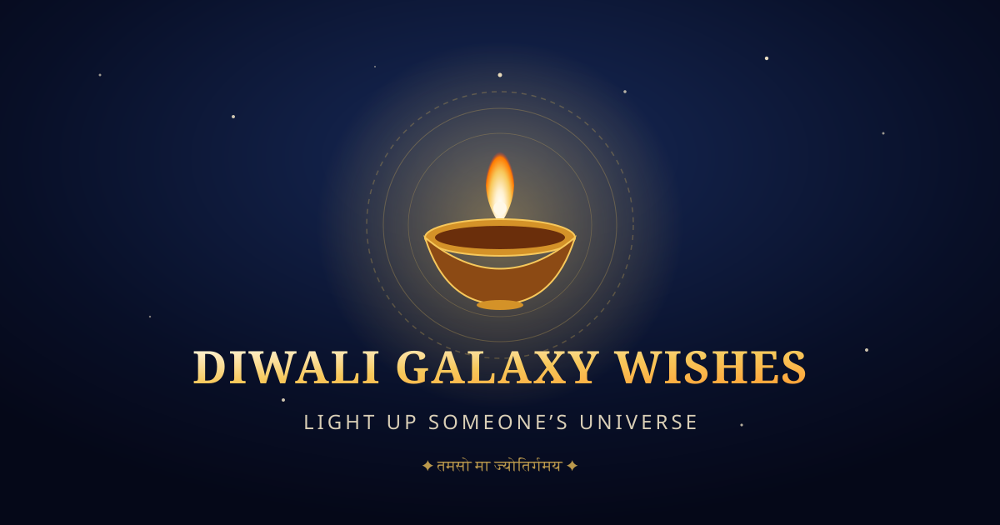

<<<<<<< HEAD
# 🪔 Diwali Galaxy Wishes — “Light Up Someone’s Universe”

A premium, interactive, mobile-first Diwali greeting web application combining a magical cosmic galaxy, glowing golden diyas, sacred Vedic blessings, interactive sky lanterns, rangoli art, and personalized greetings that can be shared across the universe.



---

## ✨ Full Feature Suite

- **Cosmic Galaxy Visual Experience**:
  - Multi-depth canvas starry sky with twinkling stars, drifting golden cosmic dust, and celestial nebulae.
  - Floating illuminated perimeter diyas drifting gently along the viewport edges.
  - Luminous 12-petal sacred Lotus Mandala rotating gracefully behind a grand brass and clay Diya with realistic flickering flame.
  - Indian festive color palette: Cosmic Midnight (`#080F27`), Deep Nebula Blue (`#172957`), Diya Gold (`#F7C85B`), Warm Ivory (`#FFF1D0`), and Celestial Lavender (`#B9B8FF`).

- **Interactive Diya Garden (“Light a Diya”)**:
  - 7 artisanal diyas representing Health (*Arogya*), Peace (*Shanti*), Abundance (*Lakshmi*), Wisdom (*Vidya*), Love (*Preeti*), Victory (*Vijaya*), and Joy (*Ananda*).
  - Genuine interactive buttons that ignite flames, illuminate surroundings, release golden particle bursts, and unlock sacred Vedic blessings with Sanskrit shlokas and English translations.
  - Features real-time counters, multi-diya lighting, and a relight/reset option.

- **Sacred Akash Deep Ritual (“Sky Lantern Sanctuary”)**:
  - Release a floating sky lantern carrying your personal prayer or wish into the starlit cosmic night.
  - Floating physics with realistic sway and gentle ascent.
  - Hover over existing lanterns to view prayers released by visitors around the world.

- **Interactive Cosmic Rangoli Designer (“Cosmic Sand Art”)**:
  - Draw sacred geometric mandalas with real-time **6x, 8x, or 12x** radial symmetry.
  - Place Glowing Diyas, Mandala Petals, and Starlight Sparkles across 6 festive colors.
  - Download custom Rangoli creations as high-resolution PNG images.

- **The Five Sacred Days of Diwali Guide (“Pancha Parva”)**:
  - Interactive calendar detailing *Dhanteras*, *Choti Diwali / Naraka Chaturdashi*, *Lakshmi Puja*, *Govardhan Puja / Annakut*, and *Bhai Dooj*.
  - Authentic spiritual significance, rituals, and auspicious Vedic mantras for each day.

- **Personalized Wish Studio**:
  - Real-time interactive greeting card preview reflecting chosen theme borders, diya emblems, and recipient attributions.
  - 3D tactile perspective tilt following cursor movement on desktop (with reduced-motion and touch safety).
  - 7 Festive Categories: Family, Friends, Love, Prosperity, Happiness, Success, and Universal.
  - 3 Distinctive Themes: **Golden Galaxy**, **Royal Blue**, and **Traditional Diwali**.
  - Multilingual Unicode support preserving **Bengali (বাংলা)**, **Hindi (हिन्दी)**, and international scripts (`শুভ দীপাবলি`, `शुभ दीपावली`, `🪔✨`).

- **Magical Floating Wish Envelope**:
  - Floating golden cosmic envelope sealed with an auspicious diya flame seal.
  - Interactive flap-unfolding animation revealing the personalized greeting card with golden sparkle bursts.
  - Dedicated shared URL route (`/wish?to=...&from=...&msg=...&cat=...&thm=...`) with client-side URL-safe decoding.

- **The Constellation of Community Wishes**:
  - Global wish wall with category filters and interactive "Send Light" sparks counter.
  - Add your wish with location attribution, protected by friendly client-side moderation.
  - 1-click "Open Envelope" action to view any community wish in the 3D celestial envelope.

- **Sharing, QR Codes & Export**:
  - **Direct Mobile Scan QR Code**: Instant QR code generator to scan from monitor to phone.
  - **WhatsApp Sharing**: Formatted festive message with recipient names and share link.
  - **Verified Clipboard Copy**: Copy link with verified feedback.
  - **Web Share API**: Device sharing sheet on mobile.
  - **PNG Greeting Card Export**: Crisp, high-resolution PNG download powered by `html-to-image`.

- **Procedural Sound Engine**:
  - Zero external audio assets — 100% synthesized via Web Audio API.
  - Switch between **Celestial Tanpura Drone** and **Temple Night Bells**.
  - Integrated volume slider and status indicators in the navigation bar.

- **Mobile App & PWA Ready**:
  - Configured with `manifest.json`, viewport safe-areas, and touch targets ≥ 44×44px.

---

## 🛠️ Technology Stack

| Technology | Purpose |
|------------|---------|
| **React 18 + TypeScript** | Component architecture and strict type safety |
| **Vite** | Build tooling and development server |
| **Tailwind CSS** | Custom cosmic design system, gradients, and typography |
| **Framer Motion** | 3D envelope unfold and staggered entrance animations |
| **Lucide React** | Clean, accessible festive icons |
| **React Router v6** | Client-side routing (`/`, `/create`, `/wish`, `/about`) |
| **html-to-image** | High-DPI PNG greeting card generation and download |
| **canvas-confetti** | Celebratory golden particle effects |
| **Web Audio API** | Procedural harmonic ambient soundscapes and audio cues |

---

## 🚀 Quick Start & Local Setup

### Prerequisites
- Node.js 18+ (tested with Node.js LTS v24)
- npm or pnpm

### 1. Installation
```bash
npm install
```

### 2. Run the Development Server
```bash
npm run dev
```
Open `http://localhost:5173` in your browser.

### 3. Production Build
```bash
npm run build
```
Output generated in `dist/`.

---

## 📜 License
Created with devotion for Diwali celebrations. Free to use and share across the universe. Shubh Deepavali!

